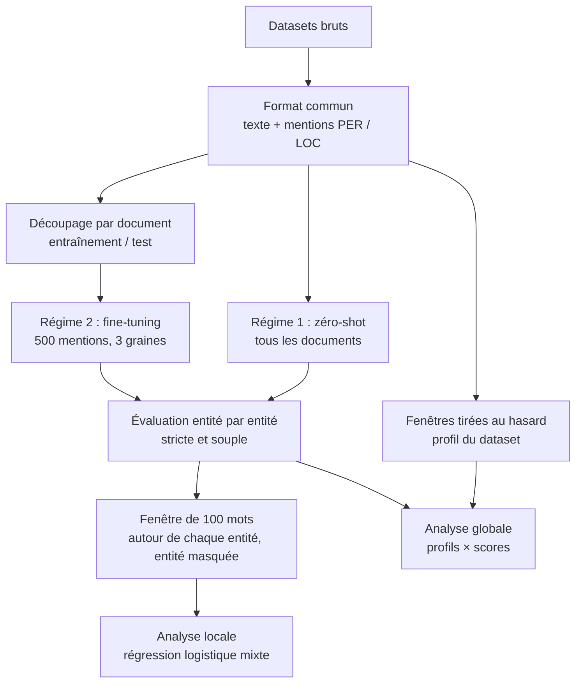

# Comment tester la sensibilité des modèles NER à la rigidité des textes

*Rapport technique : protocole expérimental du projet IJDAR 2026 (ANR DECIDON)*

Ce document décrit la méthode expérimentale de l'étude :
- quels modèles de reconnaissance d'entités nommées sont utilisés, et comment ils sont entraînés ;
- comment leurs prédictions sont évaluées ;
- comment les erreurs sont mises en relation avec la rigidité des textes ;
- quelles conclusions on pourra en tirer, et lesquelles on ne pourra pas tirer.

Il complète le rapport [Comment mesurer la rigidité d'un texte](../experiments/rigidity-indicators/indicateurs-rigidite.md), qui définit les
indicateurs de rigidité. Les deux documents sont conçus pour servir de base à la section « Méthode »
de l'article.

Chaque section s'ouvre sur un résumé en langage courant (dans un bloc de citation), puis donne le
détail. Les termes techniques sont définis à la [section 2](#s2). Les choix qui restent à faire sont
regroupés dans la [section 14](#s14) ; ils sont signalés dans le texte par la mention « (à décider) ».

**Sommaire**

1. [Questions de recherche](#s1)
2. [Vocabulaire](#s2)
3. [Vue d'ensemble du protocole](#s3)
4. [Données et harmonisation des annotations](#s4)
5. [Pourquoi le régime d'entraînement compte, et lequel choisir](#s5)
6. [Régime 1 : modèle généraliste sans entraînement (zéro-shot)](#s6)
7. [Régime 2 : modèle fine-tuné sur chaque dataset, à budget égal](#s7)
8. [Évaluation des prédictions](#s8)
9. [Analyse à l'échelle globale](#s9)
10. [Analyse à l'échelle locale](#s10)
11. [Hypothèses et lecture des résultats](#s11)
12. [Contrôles de robustesse](#s12)
13. [Limites](#s13)
14. [Décisions restant à prendre](#s14)
15. [Références](#s15)

---

## 1. Questions de recherche

> **En bref.** On veut savoir si les modèles de reconnaissance d'entités nommées se trompent davantage
> sur les textes rigides, à deux échelles : celle d'un corpus entier et celle du contexte immédiat
> d'une entité. On veut aussi comprendre pourquoi : parce que ces textes sont difficiles en eux-mêmes,
> ou parce qu'ils ne ressemblent pas aux textes sur lesquels les modèles ont appris ?

Le rapport sur les indicateurs distingue deux formes de rigidité :

* **l'axe liste ↔ phrase.** Une liste remplace la phrase par des champs séparés par des signes
  (« Martin, épicier, r. de Seine, 12 »). On le mesure par le formatage typographique et par la balance
  phrastique.
* **la formularité.** Un texte formulaire garde la phrase mais la répète d'un document à l'autre (actes
  de mariage, comptes rendus de procès). On la mesure par le Self-BLEU de la fenêtre contre le reste du
  dataset, mesure standard de la reprise de suites de mots ; la part du texte prise dans des gabarits
  fréquents (la « formularité » du rapport) en est le complément lisible.

La densité d'entités, mesurée par la part de noms propres, est traitée comme une variable distincte :
un annuaire est à la fois rigide et très dense en entités, et il faut pouvoir séparer les deux effets.

L'étude pose quatre questions :

| | question | échelle |
|---|---|---|
| Q1 | Les modèles obtiennent-ils de moins bons scores sur les corpus les plus rigides ? | globale |
| Q2 | À l'intérieur d'un même corpus, une entité est-elle plus souvent manquée, ou une prédiction plus souvent fausse, quand son contexte immédiat est plus rigide ? | locale |
| Q3 | Les effets de la rigidité dépendent-ils de ce que le modèle a vu pendant son entraînement ? | les deux |
| Q4 | Les effets de la rigidité se distinguent-ils de ceux de la densité d'entités ? | locale |

## 2. Vocabulaire

| terme | définition dans ce document |
|---|---|
| entité nommée, mention | Un nom de personne (PER) ou de lieu (LOC) dans le texte. Une même personne peut apparaître dans plusieurs mentions. |
| span | La portion de texte qu'occupe une mention, définie par sa position de début et de fin (en caractères). |
| gold | L'annotation de référence, faite à la main par les auteurs du dataset. |
| prédiction | Une mention proposée par le modèle : un span et un type. |
| vrai positif, faux positif, faux négatif (TP, FP, FN) | Un TP est une prédiction qui correspond à une mention gold. Un FP est une prédiction sans mention gold correspondante. Un FN est une mention gold qu'aucune prédiction ne retrouve. |
| précision, rappel, F1 | Précision = TP / (TP + FP) : part des prédictions qui sont justes. Rappel = TP / (TP + FN) : part des mentions gold retrouvées. F1 : moyenne harmonique des deux. |
| correspondance stricte, souple | Stricte : même début, même fin et même type. Souple : les deux spans se recouvrent d'au moins un caractère et ont le même type ([section 8](#s8)). |
| préentraînement | L'apprentissage initial d'un modèle sur de très grandes quantités de texte, avant toute adaptation à notre tâche. Nous ne le refaisons pas. |
| checkpoint | Un état précis d'un modèle publié, désigné par un nom et une version. |
| zéro-shot | Utilisation d'un modèle sans lui fournir aucun exemple annoté du dataset évalué. |
| fine-tuning | Poursuite de l'entraînement d'un modèle sur des exemples annotés d'un dataset, pour l'y adapter. |
| graine aléatoire | Le nombre qui fixe le hasard d'un entraînement (initialisation, ordre des exemples). Deux graines différentes donnent deux modèles un peu différents à partir des mêmes données. |
| dataset, sous-corpus, document | Un dataset est une ressource publiée (ex. HIPE-2022 hipe2020). Un sous-corpus en est une partie homogène, par exemple une langue ou une variante d'OCR (hipe2020-fr). Un document est l'unité de texte que nous ne coupons jamais : une page, un article, un acte, un procès. |
| fenêtre | Une suite de 100 mots consécutifs sur laquelle on calcule les indicateurs de rigidité. |
| ancrage | Le span sur lequel une fenêtre locale est centrée : une mention gold ou une prédiction. |
| masquage | Le retrait des mots d'une entité des comptages, pour que les indicateurs décrivent son contexte et non l'entité elle-même. |
| effet aléatoire | Dans un modèle statistique, un terme propre à chaque groupe (chaque sous-corpus, chaque document) qui absorbe ce que les observations d'un même groupe ont en commun ([section 10](#s10)). |

## 3. Vue d'ensemble du protocole

> **En bref.** On ramène tous les datasets à deux types d'entités, personnes et lieux. On fait
> tourner un même modèle de deux façons : tel quel, puis adapté à chaque dataset avec la même petite
> quantité d'exemples. On compare ses prédictions au gold, entité par entité. On relie ensuite chaque
> succès ou échec à la rigidité du corpus et à celle du contexte de l'entité.

Les étapes :

1. **Préparer les données.** Chaque dataset est converti dans un format commun : texte et spans des
   mentions (déjà fait, scripts dans `experiments/rigidity-indicators/dataset-validation/`). Les annotations sont ramenées à PER et LOC
   ([section 4](#s4)).
2. **Découper.** Pour chaque dataset, on sépare des documents d'entraînement et des documents de test,
   sans jamais couper un document ([section 7](#s7)).
3. **Prédire.**
   * En régime 1, un modèle généraliste annote tous les documents sans entraînement.
   * En régime 2, le même modèle est fine-tuné sur les documents d'entraînement de chaque dataset, avec
     trois graines, puis annote les documents de test.
4. **Évaluer.** Chaque mention gold et chaque prédiction reçoit un résultat : trouvée, erreur de
   frontière, erreur de type, manquée ou fausse ([section 8](#s8)).
5. **Mesurer la rigidité.**
   * À l'échelle globale, on calcule le profil de chaque dataset sur des fenêtres tirées au hasard (déjà
     fait).
   * À l'échelle locale, on calcule les indicateurs sur une fenêtre de 100 mots centrée sur chaque
     entité, l'entité étant masquée.
6. **Analyser.**
   * Échelle globale : corrélations entre profils et scores, à titre descriptif ([section 9](#s9)).
   * Échelle locale : un modèle statistique qui explique le résultat de chaque entité par la rigidité de
     son contexte, celle de son document et celle de son sous-corpus, la densité de noms propres et des
     variables de contrôle ; les effets de la rigidité y sont lus à l'intérieur des sous-corpus, donc à
     langue constante ([section 10](#s10)).

## 4. Données et harmonisation des annotations

> **En bref.** Les datasets n'annotent pas les mêmes choses de la même façon. Certains distinguent
> dix types d'entités, d'autres trois ; certains annotent « la ville » comme un lieu, d'autres seulement
> « Paris ». Pour comparer, on ne garde que les personnes et les lieux désignés par un nom propre,
> c'est-à-dire ce que tous les datasets annotent. Les différences de frontières qui subsistent sont
> absorbées par la correspondance souple.

### 4.1 Pourquoi seulement PER et LOC

Les datasets ont été retenus parce qu'ils annotent au moins les personnes et les lieux, ou permettent
de les reconstruire (M-POPP annote séparément prénoms, noms, numéros et noms de voie). Les autres
types (organisations, œuvres, dates, métiers…) n'existent que dans certains datasets, et leurs
définitions varient. Les garder introduirait des écarts de score qui tiennent aux consignes
d'annotation, pas aux textes.

### 4.2 Correspondance des étiquettes

| dataset | étiquettes gardées comme PER | étiquettes gardées comme LOC | traitement particulier |
|---|---|---|---|
| hipe2020, letemps, newseye (HIPE-2022) | `pers` / `PER` | `loc` / `LOC` | niveau « coarse », sens littéral |
| ajmc (HIPE-2022) | `pers` | `loc` | presque pas de lieux (24 à 43 mentions) : en pratique, PER seulement |
| SoDUCo | `PER` | `SPAT` (adresse, numéro compris) | `ACT` (métier) et `TITRE` écartés |
| M-POPP | prénoms et noms (contigus, même personne) | ville, numéro, type et nom de voie, département (une adresse contiguë = une mention) | entités reconstruites à partir des symboles de l'encodage 1 |
| 7romans | `PER` | `LOC` | — |
| GeoEDdA | `NP-Person` | `NP-Spatial` | noms communs (`NC-*`) et entités imbriquées descriptives (`ENE-*`) écartés |
| LitBank | `PER` désignés par un nom propre | `LOC`, `GPE` désignés par un nom propre | les mentions par nom commun (« the streets ») sont écartées grâce à la couche de coréférence, qui marque chaque mention `PROP` ou `NOM` (à faire dans `chargeurs.py`) |
| E-NER | `PERSON` | `LOCATION` | — |
| COPIOUS | `Person` | `GeographicalLocation` | — |
| Bâle | `persName` | `placeName` | — |
| Old Bailey | `persName` (accusés, victimes, témoins…) | `placeName` (rare) | annotation partielle : seuls les participants au procès sont annotés, une fois par rôle |
| NEM.fr | `PERS` | `LOC` | — |
| DECIDON CR JORF | `PER`, `SPK`, `FCT` (selon la table des datasets) | à préciser | en attente du gold de référence |

### 4.3 Volumes disponibles

Mentions PER et LOC après correspondance, tous documents confondus :

| sous-corpus | langue | documents | PER | LOC |
|---|---|---|---|---|
| hipe2020-fr / -de / -en | fr / de / en | 244 / 185 / 126 | 3 706 / 1 850 / 558 | 4 717 / 2 923 / 565 |
| letemps-fr | fr | 516 | 4 086 | 6 367 |
| newseye-fr / -fi / -sv | fr / fi / sv | 140 / 93 / 84 | 6 664 / 1 306 / 1 274 | 6 099 / 1 422 / 1 586 |
| ajmc-fr / -en / -de | fr / en / de | 104 / 86 / 106 | 839 / 833 / 910 | 24 / 43 / 43 |
| soduco-ref / -pero | fr | 78 pages | 8 772 / 8 446 | 8 985 / 8 655 |
| m-popp-printed / -handwritten | fr | 145 / 314 pages | 5 170 / 4 701 | 4 253 / 3 604 |
| 7romans | fr | 7 romans | 27 401 | 5 942 |
| geoedda | fr | 17 volumes | 1 919 | 5 691 |
| litbank (noms propres seulement) | en | 100 extraits | 2 665 | 681 |
| e-ner | en | 52 | 631 | 1 027 |
| copious | en | 668 | 2 889 | 9 990 |
| basel | de | 98 groupes d'actes | 2 583 | 1 735 |
| old-bailey (échantillon de 40 sessions) | en | 4 088 procès | 22 268 | 257 |
| 12 genres de NEM.fr | fr | 2 à 26 par genre | 5 à 139 par genre | 14 à 197 par genre |

Même après harmonisation, les frontières ne sont pas définies partout de la même façon. SoDUCo
inclut le numéro dans l'adresse, M-POPP aussi, la presse non. C'est pourquoi chaque score est calculé
deux fois, en correspondance stricte et en correspondance souple ([section 8](#s8)).

## 5. Pourquoi le régime d'entraînement compte, et lequel choisir

> **En bref.** Un même texte rigide peut gêner un modèle qui n'en a jamais vu, et faciliter la tâche
> d'un modèle qui en a vu beaucoup. Le résultat d'une étude sur la rigidité dépend donc de la façon
> dont les modèles ont été entraînés. Nous utilisons deux régimes avec le même modèle : sans
> entraînement, puis avec un petit entraînement sur chaque dataset. C'est la comparaison des deux qui
> permet de dire pourquoi la rigidité pèse, quand elle pèse.

### 5.1 Trois régimes possibles

| régime | ce que le modèle a vu | question à laquelle il répond |
|---|---|---|
| **Zéro-shot** | aucun exemple de nos datasets ; seulement ses données de préentraînement, en majorité des textes modernes | Un modèle prêt à l'emploi résiste-t-il aux textes rigides ? |
| **Fine-tuning sur le dataset** | quelques centaines d'exemples annotés du dataset évalué | Les textes rigides restent-ils difficiles quand le modèle en a vu quelques-uns ? Apprend-il les gabarits plutôt que la langue ? |
| **Leave-one-out** | les exemples de tous les autres datasets, mais pas de celui qui est évalué | Un modèle entraîné sur d'autres corpus historiques tient-il sur un corpus rigide qu'il ne connaît pas ? |

### 5.2 Ce que chaque propriété devrait produire selon le régime

| propriété du texte | zéro-shot | fine-tuning sur le dataset | leave-one-out |
|---|---|---|---|
| liste ↔ phrase | pénalise : le texte est loin des textes de préentraînement, et une liste fournit peu de contexte pour reconnaître une entité | aide : la position d'un nom dans l'entrée est un indice régulier, facile à apprendre | pénalise si le corpus évalué est plus proche de la liste que les corpus d'entraînement |
| formularité | effet faible : une formule reste une phrase ordinaire | aide pour les entités prises dans une formule ; pénalise celles qui en sortent ; gonfle les scores si les mêmes formules figurent à l'entraînement et au test | pénalise si les formules du corpus évalué diffèrent de celles des corpus d'entraînement |
| densité d'entités | erreurs de frontière (entités collées) et de type (peu d'indices pour trancher) | mêmes erreurs, probablement atténuées | mêmes erreurs |

Le cas du fine-tuning sur un corpus formulaire illustre un risque connu : l'apprentissage de
raccourcis [[Geirhos 2020](#ref-geirhos)]. Le modèle apprend une règle qui marche sur ses données
d'entraînement, par exemple « le mot qui suit "domiciliée à" est un lieu ». Elle est très efficace
tant que le texte suit la formule, et elle échoue dès qu'il s'en écarte.

### 5.3 Le choix : zéro-shot et fine-tuning, avec le même modèle

Nous retenons les deux premiers régimes. Utiliser un seul régime ne permettrait pas de dire pourquoi
la rigidité pèse. Les deux ensemble permettent de distinguer trois explications :

| ce qu'on observe | ce qu'on peut en conclure |
|---|---|
| la rigidité pénalise en zéro-shot, mais ne pénalise plus après fine-tuning | les textes rigides sont **inhabituels** pour le modèle ; quelques exemples du domaine suffisent à combler l'écart |
| la rigidité pénalise dans les deux régimes | les textes rigides sont **difficiles en eux-mêmes** (frontières, abréviations, peu de contexte) |
| après fine-tuning, les erreurs se concentrent sur les entités hors des formules | le modèle a appris les **gabarits** plutôt que la langue (apprentissage de raccourcis) |

Les deux régimes utilisent **le même modèle de départ**. La seule différence entre eux est alors
l'apport des exemples du dataset. Avec deux modèles différents, on ne pourrait pas séparer l'effet du
régime de celui de l'architecture.

### 5.4 Pourquoi pas le leave-one-out pour l'instant

Sa question est intéressante : c'est la situation d'un projet qui applique un modèle existant à un
nouveau fonds. Trois difficultés le font cependant passer en second :

1. **Harmonisation.** Il faudrait entraîner un modèle sur des datasets dont les consignes d'annotation
   diffèrent. L'harmonisation PER / LOC réduit ces écarts sans les supprimer, et le modèle apprendrait un
   mélange de consignes contradictoires.
2. **Datasets apparentés.** Plusieurs datasets sont des variantes les uns des autres : les deux versions
   de SoDUCo (mêmes entrées, OCR différents), les deux parties de M-POPP, les trois langues de hipe2020
   et d'ajmc. Évaluer SoDUCo-Pero avec SoDUCo-référence dans les données d'entraînement reviendrait à
   tester le modèle sur des textes qu'il a déjà vus. Il faudrait écarter des familles entières.
3. **Données d'entraînement variables.** Le mélange d'entraînement change à chaque dataset écarté. Un
   score plus bas sur un dataset peut donc venir de ce qui manquait à l'entraînement, et pas de la
   rigidité du dataset évalué.

On pourra le faire dans un second temps sur quelques familles de corpus, par exemple en écartant tour
à tour les annuaires, les actes et la presse.

## 6. Régime 1 : modèle généraliste sans entraînement (zéro-shot)

> **En bref.** Un modèle déjà entraîné à reconnaître des entités de n'importe quel type reçoit les mots
> « person » et « location » et annote nos textes sans en avoir vu aucun exemple. C'est la situation
> d'un projet qui utilise un outil prêt à l'emploi. Le régime est simple et couvre tous les datasets,
> mais son score mêle deux choses : la difficulté du texte et l'écart entre la façon dont le modèle
> comprend « personne » ou « lieu » et les consignes de chaque dataset.

**Le modèle.** Nous utilisons un modèle de la famille GLiNER [[Zaratiana 2024](#ref-gliner)]. Son
principe : on lui fournit, sous forme de mots, la liste des types d'entités à chercher, et il évalue
chaque portion de texte candidate. Il peut ainsi reconnaître des types qu'il n'a pas vus pendant son
entraînement. GLiNER2 [[Zaratiana 2025](#ref-gliner2)], déjà utilisé dans le projet pour les CR du JORF,
étend ce principe à d'autres tâches d'extraction. Le checkpoint doit traiter les cinq langues de
l'étude (français, anglais, allemand, finnois, suédois) (à décider).

**Les types demandés.** « person » et « location », en anglais, pour toutes les langues, afin que la
consigne donnée au modèle soit la même partout.

**Le seuil.** Le modèle attribue un score de confiance à chaque span candidat. Un span est retenu si son
score dépasse un seuil. Ce seuil est fixé une fois pour toutes (à décider) : la valeur par défaut de
la bibliothèque, ou une valeur choisie sur un essai pilote qui ne sert pas à l'analyse. L'ajuster
dataset par dataset reviendrait déjà à adapter le modèle à chaque corpus, ce qui brouillerait la
comparaison avec le régime 2.

**Le découpage des textes.** Le modèle ne traite qu'une longueur de texte limitée. Chaque document est
découpé en segments qui se chevauchent légèrement. Quand une même mention est prédite dans deux
segments, on garde la prédiction de plus fort score. Le découpage est le même pour tous les datasets.

**Les documents annotés.**
* Pour l'analyse globale, tous les documents de tous les datasets, y compris les genres de NEM.fr, trop
  petits pour le fine-tuning.
* Pour la comparaison avec le régime 2, les mêmes documents de test que ceux du fine-tuning
  ([section 10.6](#s10-6)).

**La limite principale.** Un score zéro-shot bas peut venir du texte ou des consignes. Par exemple, le
modèle peut ne pas considérer « r. de Seine, 12 » comme un lieu, alors que SoDUCo l'annote ainsi.
Deux précautions réduisent ce problème :
* la correspondance souple ([section 8](#s8)) ;
* surtout, la comparaison d'entités d'un même dataset à l'échelle locale ([section 10](#s10)), où les
  consignes sont les mêmes pour toutes les entités comparées.

## 7. Régime 2 : modèle fine-tuné sur chaque dataset, à budget égal

> **En bref.** On reprend le même modèle et on l'entraîne un peu sur chaque dataset, toujours avec le
> même nombre d'exemples (environ 500 mentions de personnes et de lieux) et les mêmes réglages. Les
> documents d'entraînement et de test sont séparés document par document, pour qu'un modèle ne soit
> jamais testé sur un texte qu'il a vu. On répète chaque entraînement trois fois, avec trois graines
> différentes, parce qu'avec si peu d'exemples le résultat varie d'un entraînement à l'autre.

Dans cette section, « dataset » désigne l'unité sur laquelle un modèle est entraîné : un sous-corpus
homogène (une langue de hipe2020, une variante d'OCR de SoDUCo, une partie de M-POPP).

### 7.1 Un budget égal pour tous les datasets

Si chaque modèle était entraîné sur tout son dataset, un score plus élevé sur SoDUCo (17 000 mentions)
que sur ajmc (900 mentions) pourrait venir de la quantité d'exemples, et non de la rigidité. On fixe
donc **le même nombre de mentions PER et LOC à l'entraînement pour tous les datasets**.

Le budget est contraint par les plus petits datasets éligibles : ajmc (860 à 950 mentions selon la
langue), hipe2020-en (1 123) et E-NER (1 658). Avec **environ 500 mentions** à l'entraînement, il en
reste au moins 350 pour le test partout. La valeur exacte sera fixée après le filtrage définitif des
annotations (à décider).

Les genres de NEM.fr (27 à 336 mentions chacun) sont trop petits : ils ne sont évalués qu'en régime 1.

### 7.2 Découpage par document

Les documents d'entraînement sont tirés au hasard, un par un, jusqu'à atteindre le budget ; tous les
autres documents du dataset forment le test. Un document n'est jamais coupé entre entraînement et
test. Couper au milieu d'un document mettrait dans les deux ensembles les mêmes personnes, les mêmes
lieux et, dans les corpus formulaires, les mêmes formules. Or les modèles NER obtiennent des scores bien
plus élevés sur les mentions déjà vues à l'entraînement [[Augenstein 2017](#ref-augenstein)] : le test
surestimerait les performances.

Quatre cas particuliers :
* **SoDUCo.** La version de référence et la version OCR Pero contiennent les mêmes entrées. Elles
  reçoivent le même découpage, et chacune a son propre modèle.
* **7romans.** Il ne compte que 7 documents (des romans entiers). On le découpe en blocs de phrases
  consécutives à l'intérieur de chaque roman, et ce sont ces blocs qu'on répartit.
* **hipe2020-en.** Le dataset ne publie pas de partie entraînement : on découpe ses parties
  développement et test.
* **Old Bailey.** Le découpage se fait parmi les procès de l'échantillon de 40 sessions.

### 7.3 Réglages identiques et fixés à l'avance

Tous les modèles sont entraînés avec les mêmes hyperparamètres : taux d'apprentissage, taille des lots,
nombre d'étapes. Le nombre d'étapes est fixé à l'avance plutôt que déterminé par un arrêt anticipé, et
ce pour deux raisons :
- tous les modèles reçoivent exactement le même entraînement ;
- on n'a pas besoin de mettre de côté un jeu de validation, ce qui réduirait encore les petits datasets.

Les valeurs sont choisies une fois, sur un essai pilote qui sert seulement à vérifier que
l'entraînement converge, puis gelées (à décider).

### 7.4 Trois graines par dataset

Avec quelques centaines d'exemples, deux entraînements identiques à la graine près peuvent donner des
scores sensiblement différents [[Dodge 2020](#ref-dodge)]. Chaque dataset est donc entraîné trois fois,
avec le même découpage et trois graines. On rapporte la moyenne et l'écart des scores. Dans l'analyse
locale, le modèle statistique est ajusté séparément pour chaque graine ([section 10.6](#s10-6)).

### 7.5 La formularité vue par le modèle fine-tuné

En régime 2, ce qui compte est la ressemblance d'une entité de test avec ce que *ce* modèle a vu. Pour
l'analyse locale de ce régime, la référence du Self-BLEU est donc construite à partir des seuls
documents d'entraînement, et non du dataset entier. Une entité de test est « dans une formule » si son
contexte reprend des gabarits présents dans les documents d'entraînement.

## 8. Évaluation des prédictions

> **En bref.** On compare chaque prédiction au gold. Une prédiction est juste au sens strict si elle a
> exactement les mêmes limites et le même type que la mention gold, et juste au sens souple si elle la
> chevauche avec le bon type. Au-delà des scores globaux, chaque mention gold et chaque prédiction
> reçoit un résultat (trouvée, mauvaises limites, mauvais type, manquée ou fausse) : ce sont ces
> résultats qu'on relie ensuite à la rigidité.

### 8.1 Deux règles de correspondance

* **Correspondance stricte.** La prédiction et la mention gold ont le même début, la même fin et le même
  type.
* **Correspondance souple.** Les deux spans se recouvrent d'au moins un caractère et ont le même type.

C'est la distinction du scoreur de la campagne HIPE sur la presse historique [[Ehrmann 2020](#ref-hipe)],
qui parle de correspondance « stricte » et « floue ». La correspondance stricte pénalise lourdement les
erreurs de frontière. Or les consignes de frontière varient d'un dataset à l'autre (le numéro de
l'adresse, le titre devant le nom), et la correspondance souple neutralise une bonne partie de ces
écarts. On rapporte toujours les deux.

### 8.2 Le résultat de chaque mention

Chaque **mention gold** reçoit l'un de ces résultats :

| résultat | définition |
|---|---|
| trouvée | une prédiction lui correspond au sens strict |
| erreur de frontière | une prédiction du même type la chevauche, mais avec d'autres limites |
| erreur de type | une prédiction la chevauche, mais avec l'autre type (PER au lieu de LOC, ou l'inverse) |
| manquée | aucune prédiction ne la chevauche |

Chaque **prédiction** reçoit l'un de ces résultats :

| résultat | définition |
|---|---|
| correcte | une mention gold lui correspond au sens strict |
| erreur de frontière | elle chevauche une mention gold du même type, avec d'autres limites |
| erreur de type | elle chevauche une mention gold de l'autre type |
| fausse | elle ne chevauche aucune mention gold |

Exemple. Le gold annote « Charles Célestin Edouard LEPAGE » (PER) et le modèle prédit « Edouard
LEPAGE » (PER). En correspondance stricte, la mention gold est une *erreur de frontière* ; en
correspondance souple, elle est *trouvée*.

### 8.3 Scores par dataset

Pour chaque dataset, chaque régime et chaque graine, on calcule précision, rappel et F1, en
correspondance stricte et souple, sur l'ensemble des mentions (micro-moyenne), pour PER, pour LOC et
pour les deux réunis.

Pour **Old Bailey**, seule la partie rappel est interprétable. Le dataset n'annote que les participants
au procès, une fois par rôle. Une personne correctement prédite mais non annotée compterait comme
« fausse », ce qui ferait baisser artificiellement la précision.

## 9. Analyse à l'échelle globale

> **En bref.** On met en regard, dataset par dataset, le profil de rigidité et le score du modèle. Avec
> seulement seize datasets, qui diffèrent aussi par la langue, l'époque, l'OCR et les consignes
> d'annotation, cette analyse sert à décrire et à illustrer, pas à démontrer.

* **Profil de rigidité.** Pour chaque dataset, la médiane et l'écart interquartile des indicateurs,
  sur des fenêtres de 100 mots tirées au hasard dans ses documents. Ce profil est déjà calculé
  ([rapport sur les indicateurs, section 9](../experiments/rigidity-indicators/indicateurs-rigidite.md#s9)).
* **Scores.** F1, précision et rappel par dataset et par régime ([section 8.3](#s8-3)).
* **Mise en relation.** Graphiques des scores en fonction de chaque indicateur, et corrélation de rang
  de Spearman. Avec 16 datasets, une corrélation n'est significative au seuil de 5 % qu'au-delà de
  |ρ| ≈ 0,50. Les 33 sous-corpus ne sont pas indépendants les uns des autres (trois langues de
  hipe2020, deux versions de SoDUCo…) : on ne peut donc pas les compter comme 33 observations.
* **Langues.** Le Self-BLEU et la formularité dépendent de la langue, et aucun prétraitement ne corrige
  cet écart ([section 10.4](#s10-4)). On ne compare donc pas leurs valeurs entre sous-corpus de langues
  différentes : les graphiques distinguent les langues, et les corrélations sont aussi calculées sur les
  seuls sous-corpus français.

Cette analyse répond à Q1 de façon descriptive. Elle sert aussi à montrer que les datasets retenus
couvrent bien l'éventail de la rigidité, de la prose libre aux annuaires.

## 10. Analyse à l'échelle locale

> **En bref.** On s'intéresse cette fois à chaque entité. Pour chacune, on mesure la rigidité des 100
> mots qui l'entourent, sans compter l'entité elle-même, et on regarde si les entités en contexte
> rigide sont plus souvent manquées. Un modèle statistique tient compte de ce que les entités d'un même
> document ou d'un même sous-corpus se ressemblent. Il sépare la rigidité du contexte immédiat, celle du
> document et celle du sous-corpus, pour que les effets de la rigidité se lisent à langue, OCR et
> consignes constants.

### 10.1 Deux analyses, deux ancrages

Les documents évalués sont tous les documents en régime 1, et les documents de test en régime 2.

* **Analyse du rappel.** Les observations sont les mentions gold des documents évalués. La question est :
  qu'est-ce qui fait qu'une mention est trouvée ou non ? La fenêtre est centrée sur la mention gold.
* **Analyse de la précision.** Les observations sont les prédictions faites sur ces documents. La
  question est : qu'est-ce qui fait qu'une prédiction est correcte ou non ? La fenêtre est centrée sur
  la prédiction. Old Bailey est exclu ([section 8.3](#s8-3)).

On ne compare jamais des fenêtres de faux positifs à des fenêtres de faux négatifs : elles ne sont pas
centrées sur le même genre d'objet, et leur différence mêlerait l'effet de l'ancrage et celui de la
rigidité. Pour la même raison, on ne compare pas les fenêtres d'entités aux fenêtres tirées au
hasard : le voisinage d'une entité ressemble davantage à une liste qu'un passage quelconque.

### 10.2 La fenêtre de chaque entité

* **Taille.** 100 mots, comme à l'échelle globale. Les indicateurs dépendent de la longueur du texte
  mesuré, et une taille commune rend les deux échelles comparables. Le rapport sur les indicateurs
  montre que les indicateurs retenus sont fiables à cette taille.
* **Position.** Environ 50 mots avant l'entité et 50 après. Près du début ou de la fin d'un document, la
  fenêtre est décalée vers l'intérieur pour garder 100 mots, plutôt que raccourcie.
* **Masquage.** On étiquette le document entier, puis on retire des comptages les mots de l'entité
  (paramètre `exclude_spans` des fonctions du package `text_rigidity`). Supprimer l'entité du texte avant
  l'étiquetage fabriquerait une phrase artificielle (« née à , le onze mai ») qui fausserait
  l'étiquetage des mots voisins.

### 10.3 Les variables

**Variables expliquées.**
* Analyse du rappel : la mention est-elle trouvée, au sens strict (1) ou non (0) ?
* Analyse de la précision : la prédiction est-elle correcte, au sens strict (1) ou non (0) ?

L'analyse est refaite en correspondance souple ([section 12](#s12)).

Une analyse complémentaire distingue les types d'erreur (frontière, type, manquée).

**Variables de rigidité et de densité**, calculées sur la fenêtre de l'entité :
* le formatage typographique ;
* la balance phrastique ;
* la formularité, mesurée par le Self-BLEU ; sa référence est le dataset en régime 1 et les documents
  d'entraînement en régime 2 ([section 7.5](#s7-5)) ;
* la densité de noms propres.

**Variables de contrôle**, qui décrivent l'entité elle-même :
* son type (PER ou LOC) ;
* sa longueur en mots ;
* si elle est entièrement en capitales ;
* si elle contient un chiffre ;
* si elle est abrégée (point final ou interne, comme « r. » ou « J.-B. ») ;
* la qualité de l'OCR autour d'elle, mesurée par exemple par la part de mots absents d'un lexique de la
  langue (à décider).

Ces contrôles sont nécessaires : dans un annuaire, une entité peut être manquée parce qu'elle est
abrégée ou mal océrisée, et non parce que son contexte est une liste.

### 10.4 Séparer le contexte immédiat, le document et le sous-corpus

Une entité peut se trouver dans un passage plus rigide ou moins rigide que son document, et un document
peut être plus rigide ou moins rigide que les autres documents de son sous-corpus. Pour séparer ces trois
échelles, chaque indicateur entre dans le modèle sous trois formes :

* **l'écart local** : la valeur de la fenêtre de l'entité moins la moyenne de son document. Il décrit ce
  que le contexte immédiat a de plus ou de moins rigide que le reste du document ;
* **l'écart du document** : la moyenne de l'indicateur sur toutes les fenêtres d'entités du document,
  moins la moyenne de son sous-corpus. Il décrit ce que le document a de plus ou de moins rigide que les
  autres documents de la même source ;
* **la moyenne du sous-corpus** : la moyenne de l'indicateur sur toutes les fenêtres d'entités du
  sous-corpus.

Cette décomposition en effets « intra » et « inter » vient de [[Mundlak 1978](#ref-mundlak)]. Sans elle,
un coefficient unique mêlerait trois questions différentes : « les sources rigides sont-elles plus
difficiles ? », « dans une même source, les documents plus rigides sont-ils plus difficiles ? » et
« dans un même document, les passages plus rigides sont-ils plus difficiles ? ».

**Pourquoi descendre jusqu'au sous-corpus : la langue.** Le Self-BLEU et la formularité dépendent de la
langue ([note d'arbitrage, section 2](arbitrage-formulaicite.md)). Dans hipe2020 comme dans ajmc,
l'allemand reprend moins de suites de mots telles quelles que le français et l'anglais : Self-BLEU médian
de 4,4 contre 6,0 et 5,2 dans hipe2020, de 10,0 contre 14,0 et 16,3 dans ajmc. Cet écart ne vient ni de la
tokenisation ni de la flexion : il augmente si l'on retire les signes et ne baisse pas sur les lemmes
([`formularity-robustness`](../experiments/formularity-robustness/README.md)). Tirer la référence du même
sous-corpus, donc de la même langue, ne suffit pas à l'effacer : à taille égale (20 000 tokens), une
référence couvre moins bien une langue à forte morphologie. Dans NewsEye, la part des mots d'une fenêtre
retrouvés dans la référence est de 57 % en finnois contre 71 % en français, celle des paires de mots de
13 % contre 23 %. Le Self-BLEU classe donc bien les fenêtres d'un même sous-corpus, mais son niveau n'est
pas comparable d'un sous-corpus à l'autre. Si le modèle NER réussit
aussi moins bien dans une langue, un indicateur qui varie avec la langue paraîtra lié aux erreurs sans
que la rigidité y soit pour rien. Or chaque sous-corpus est d'une seule langue : l'écart local et l'écart
du document se lisent donc à langue constante, comme à OCR et à consignes constants. Les différences
entre langues sont confinées à la moyenne du sous-corpus, dont le coefficient se lit, comme l'analyse
globale ([section 9](#s9)), de façon descriptive.

Un effet aléatoire du sous-corpus ne suffirait pas à lui seul. Il absorbe le niveau de réussite propre à
chaque sous-corpus, pas le niveau de l'indicateur, et ne protège que si les deux ne sont pas liés ; c'est
précisément ce qu'on ne peut pas supposer quand la langue agit sur l'un et sur l'autre.

### 10.5 Le modèle statistique

On ajuste une régression logistique à effets mixtes [[Gelman & Hill 2007](#ref-gelman)]. Une
régression logistique explique une probabilité, ici celle qu'une entité soit trouvée, par un ensemble
de variables. Elle ne modélise pas directement la probabilité $P$, mais son logit,
$\log\big(P / (1 - P)\big)$, qui peut prendre n'importe quelle valeur : chaque variable y ajoute sa
contribution.

$$
\operatorname{logit} P(y_{e} = 1) =
\beta_0
+ \sum_{k} \beta_k^{\text{local}} \,(x_{k,e} - \bar x_{k,d})
+ \sum_{k} \beta_k^{\text{doc}} \,(\bar x_{k,d} - \bar x_{k,s})
+ \sum_{k} \beta_k^{\text{sc}} \,\bar x_{k,s}
+ \gamma \cdot c_e
+ u_{s} + v_{d}
$$

* $y_e$ vaut 1 si l'entité $e$ est trouvée (analyse du rappel) ou correcte (analyse de la précision) ;
* $x_{k,e}$ est la valeur de l'indicateur $k$ dans la fenêtre de l'entité, $\bar x_{k,d}$ sa moyenne
  dans le document $d$ et $\bar x_{k,s}$ sa moyenne dans le sous-corpus $s$ ([section 10.4](#s10-4)) ;
* $c_e$ regroupe les variables de contrôle de l'entité ;
* $u_s$ et $v_d$ sont des effets aléatoires du sous-corpus $s$ et du document $d$.

Les coefficients qui répondent aux questions de l'étude sont $\beta^{\text{local}}$ et
$\beta^{\text{doc}}$, estimés à langue constante. $\beta^{\text{sc}}$ repose sur une trentaine de
sous-corpus qui diffèrent aussi par la langue, l'OCR et les consignes : il est rapporté sans être
interprété comme un effet de la rigidité.

Les effets aléatoires répondent à un problème simple. Les entités d'un même document ou d'un même
sous-corpus ne sont pas indépendantes : elles partagent la même qualité d'OCR, les mêmes consignes
d'annotation, souvent les mêmes formules, et leurs fenêtres se chevauchent. Les traiter comme des
observations indépendantes donnerait une fausse impression de précision. Les effets aléatoires
absorbent ce que les entités d'un même groupe ont en commun.

En pratique :
* les indicateurs sont centrés et réduits sur l'ensemble des fenêtres, c'est-à-dire ramenés à une
  moyenne de 0 et un écart-type de 1, avant d'être décomposés, pour que leurs coefficients soient
  comparables entre eux. Un écart d'un écart-type n'a pas forcément le même sens dans toutes les
  langues : le Self-BLEU varie moins dans la presse finnoise que dans les commentaires anglais d'ajmc. Un
  contrôle réduit les écarts à l'intérieur de chaque sous-corpus ([section 12](#s12)) ;
* chaque coefficient est rapporté comme un rapport de cotes. La cote d'une entité est le rapport entre
  sa probabilité d'être trouvée et sa probabilité d'être manquée ; le rapport de cotes indique par
  combien cette cote est multipliée quand l'indicateur augmente d'un écart-type. Une valeur de 0,8
  signifie que la cote baisse de 20 % ;
* le modèle peut être ajusté avec la bibliothèque R `lme4` [[Bates 2015](#ref-lme4)] ou un équivalent ;
* avant d'interpréter les coefficients, on vérifie que les variables ne sont pas trop liées entre elles.
  La densité de noms propres corrèle à 0,69 avec le formatage typographique dans les fenêtres
  françaises : si deux variables évoluent presque toujours ensemble, le modèle ne peut pas attribuer
  l'effet à l'une plutôt qu'à l'autre. Une mesure usuelle est le facteur d'inflation de la variance ;
  au-delà d'environ 5, on regroupe les variables concernées ou on en retire une.

### 10.6 Comparer les deux régimes

Pour répondre à Q3, les deux régimes sont évalués sur les mêmes documents de test, ceux du découpage du
régime 2. Chaque mention de test a donc un résultat en zéro-shot et un résultat après fine-tuning.

On ajuste alors un seul modèle sur les deux séries de résultats, en ajoutant :
* une variable « régime » (zéro-shot ou fine-tuning) ;
* ses interactions avec chaque indicateur ;
* un effet aléatoire par mention, puisque chaque mention apparaît deux fois.

L'interaction répond directement à la question : « l'effet de la rigidité change-t-il quand le modèle a
vu des exemples du dataset ? ». En régime 2, l'analyse est faite pour chacune des trois graines, et on
rapporte la moyenne et l'écart des coefficients.

## 11. Hypothèses et lecture des résultats

> **En bref.** Avant de lancer les expériences, on écrit ce qu'on s'attend à observer et ce que chaque
> résultat voudrait dire. Cela évite de construire l'interprétation après coup, en fonction de ce qui
> sort.

| | hypothèse | ce qui la confirmerait | régime |
|---|---|---|---|
| H1 | Les textes en liste gênent un modèle qui n'en a jamais vu. | En zéro-shot, le rappel baisse quand la balance phrastique baisse et quand le formatage typographique augmente, à l'échelle du document et à l'échelle locale. | 1 |
| H2 | Quelques exemples suffisent à lever cette gêne. | L'effet de H1 diminue nettement en régime 2 (interaction régime × indicateur). | 1 et 2 |
| H3 | Un modèle fine-tuné sur un corpus formulaire s'appuie sur les formules. | En régime 2, dans les datasets formulaires, le rappel est plus élevé pour les entités dont le contexte est formulaire, et nettement plus bas pour celles qui en sortent. | 2 |
| H4 | La densité d'entités a un effet propre. | La densité de noms propres reste associée aux erreurs, surtout de frontière, une fois la rigidité prise en compte, dans les deux régimes. | 1 et 2 |
| H5 | La rigidité du contexte immédiat compte en plus de celle du document. | Les coefficients d'écart local sont non nuls, en plus de ceux de l'écart du document. | 1 et 2 |

Un résultat contraire à une hypothèse est aussi informatif. Si H1 n'est pas confirmée, par exemple,
c'est que les modèles généralistes actuels gèrent bien les listes et que les écarts de score entre
datasets viennent d'ailleurs : consignes, OCR ou langue.

## 12. Contrôles de robustesse

> **En bref.** Chaque conclusion importante est vérifiée par une seconde voie, pour s'assurer qu'elle ne
> tient pas à un choix particulier du protocole.

* **Correspondance souple au lieu de stricte.** Les conclusions doivent tenir avec les deux règles. Si un
  effet n'apparaît qu'en correspondance stricte, il porte sur les frontières et non sur la détection.
* **Autres tailles de fenêtre.** On refait l'analyse locale avec des fenêtres de 50 et de 200 mots.
* **Formularité au lieu du Self-BLEU.** On refait le modèle principal avec la formularité du rapport
  (gabarits vus au moins 3 fois, noms et nombres masqués) à la place du Self-BLEU. Les deux mesures
  classent les datasets de la même façon, mais divergent à l'intérieur d'un dataset : le Self-BLEU compte
  aussi la phraséologie ordinaire, la formularité suit davantage la densité de noms propres. La lecture
  des résultats et le choix de la mesure pour l'article suivent une règle fixée à l'avance :
  [Mesurer la formulaicité : Self-BLEU ou formularité ?](arbitrage-formulaicite.md).
* **Langue constante.** On refait le modèle principal sur les seuls sous-corpus français, les plus
  nombreux. Un effet qui tient en français seul ne vient pas de la langue.
* **Pente selon la langue.** Sur les sous-corpus français, anglais et allemands, on ajoute au modèle une
  interaction entre la langue et l'écart local, puis l'écart du document, de chaque indicateur. Si la pente
  change de sens d'une langue à l'autre, on ne rapporte pas d'effet commun. Le finnois et le suédois, qui ne
  comptent qu'un sous-corpus chacun, n'entrent pas dans ce contrôle.
* **Réduction par sous-corpus.** On refait le modèle en divisant l'écart local et l'écart du document par
  l'écart-type de l'indicateur dans chaque sous-corpus. Les conclusions ne doivent pas dépendre de la
  façon dont l'ampleur de la variation diffère d'une langue ou d'une source à l'autre.
* **Profil par mot.** Pour chaque mot du texte, on calcule les indicateurs sur une fenêtre glissante
  centrée sur lui. On calcule ensuite le taux d'erreur des mots appartenant à une entité, par tranche
  de rigidité locale. Ce contrôle ne dépend d'aucun choix d'ancrage.
* **Datasets à contraste interne.** Trois datasets contiennent des parties rigides et des parties libres :
  * M-POPP : actes dactylographiés et actes manuscrits ;
  * CR du JORF : listes de votes et discours ;
  * Old Bailey : formules d'ouverture des procès et témoignages.

  La langue, les consignes d'annotation et le modèle y sont constants : la comparaison entre leurs
  parties est la plus probante de l'étude.
* **OCR.** SoDUCo existe en version de référence et en version OCR Pero sur les mêmes entrées : la
  comparaison isole l'effet de l'OCR.
* **Étiquetage.** On refait l'analyse sans les datasets où l'étiqueteur grammatical est le moins fiable :
  Bâle (allemand des XVe–XVIIIe siècles) et ajmc (citations grecques).

## 13. Limites

> **En bref.** L'étude est observationnelle : on ne fabrique pas des textes plus ou moins rigides, on
> observe des textes qui le sont. Les conclusions portent donc sur des associations, que les contrôles
> et les comparaisons internes rendent plus ou moins convaincantes.

* **Facteurs confondus.** Les textes les plus rigides sont aussi souvent les plus anciens, les plus
  bruités par l'OCR et les plus denses en entités. Les variables de contrôle et les datasets à contraste
  interne réduisent ce problème sans le supprimer.
* **Peu de datasets.** Seize datasets ne suffisent pas pour une inférence solide à l'échelle globale ;
  les conclusions reposent sur l'échelle locale.
* **Langue.** Le Self-BLEU et la formularité dépendent de la langue, et l'ampleur de cet effet ne peut
  pas être mesurée proprement : dans nos corpus, la langue se confond presque toujours avec la source, et
  aucun corpus parallèle n'est disponible. Le modèle s'en protège en ne lisant les effets de la rigidité
  qu'à l'intérieur des sous-corpus ([section 10.4](#s10-4)). Le finnois et le suédois ne sont représentés
  que par un sous-corpus de presse chacun (NewsEye) : on ne peut pas y comparer des sources plus ou moins
  rigides, seulement des documents et des passages d'une même source.
* **Consignes d'annotation.** L'harmonisation PER / LOC et la correspondance souple réduisent les écarts
  entre consignes, mais une part subsiste, surtout en zéro-shot.
* **Annotation partielle.** Old Bailey n'annote que certains participants : seule l'analyse du rappel y
  est possible.
* **Données de préentraînement.** On ne sait pas exactement sur quels textes les modèles ont été
  préentraînés. Des datasets modernes et publics (WikiNER dans NEM.fr, par exemple) ont pu en faire
  partie, ce qui avantagerait le modèle sur ces textes.
* **Petit budget d'entraînement.** 500 mentions, c'est peu : les scores du régime 2 varient d'une graine
  à l'autre, d'où les trois graines.
* **Indicateurs imparfaits.** Les indicateurs grammaticaux reposent sur un étiqueteur entraîné sur la
  langue moderne. Le Self-BLEU et la formularité dépendent de la taille et de l'homogénéité du dataset
  (rapport sur les indicateurs, [section 8](../experiments/rigidity-indicators/indicateurs-rigidite.md#s8)),
  ainsi que de la langue (voir plus haut).

## 14. Décisions restant à prendre

| décision | options | recommandation | dépend de |
|---|---|---|---|
| checkpoint du modèle | GLiNER2 (déjà utilisé pour les CR du JORF), un GLiNER multilingue | celui déjà utilisé pour les CR du JORF, s'il couvre les cinq langues | vérification sur fi et sv |
| budget d'entraînement | 300 à 600 mentions PER + LOC | environ 500 | décompte après filtrage définitif (LitBank, DECIDON) |
| nombre de graines | 3 ou 5 | 3, à porter à 5 si l'écart entre graines est grand | temps de calcul disponible |
| seuil de confiance en zéro-shot | valeur par défaut, valeur fixée sur un pilote | une valeur unique, fixée avant l'analyse | essai pilote |
| hyperparamètres du fine-tuning | valeurs par défaut de la bibliothèque, valeurs d'un pilote | une valeur unique, gelée après le pilote | essai pilote |
| mesure de la qualité de l'OCR | part de mots absents d'un lexique, perplexité normalisée | part de mots absents d'un lexique, plus simple et disponible dans toutes les langues | lexiques par langue |
| second modèle zéro-shot | aucun, un grand modèle de langue génératif | optionnel : utile pour tester les omissions dans les longues énumérations, plus coûteux | budget |
| finnois et suédois | garder, écarter | les garder si le checkpoint les couvre : avec la décomposition de la [section 10.4](#s10-4), ils ne pèsent que sur des coefficients estimés à langue constante ; ils n'apportent qu'un genre, la presse | couverture du checkpoint ; lexiques pour mesurer l'OCR |
| mesure de la formulaicité | Self-BLEU, formularité | Self-BLEU à titre provisoire ; les deux calculées partout | analyse de sensibilité, selon la règle de [la note d'arbitrage](arbitrage-formulaicite.md) |
| calcul | — | inférence zéro-shot : légère ; fine-tuning : une soixantaine de petits entraînements (une vingtaine de sous-corpus × 3 graines) | disponibilité du GPU |

Actions préalables sur les données :
* filtrer LitBank aux mentions par nom propre, à partir de sa couche de coréférence ;
* intégrer le gold de référence des CR du JORF ;
* confirmer la sélection d'Old Bailey et l'encodage de M-POPP servant de gold.

## 15. Références

Vérifiées en ligne (notices bibliographiques) : Augenstein 2017, Bates 2015, Dodge 2020, Ehrmann 2020,
Geirhos 2020, Gelman & Hill 2007, Mundlak 1978, Zaratiana 2024, Zaratiana 2025. La description des
deux modes du scoreur HIPE (strict et flou) vient de sa documentation et de travaux qui l'utilisent.

**[Augenstein 2017]** I. Augenstein, L. Derczynski and K. Bontcheva. *Generalisation in named entity recognition: A quantitative analysis.* Computer Speech & Language, 44:61–83, 2017.

**[Bates 2015]** D. Bates, M. Mächler, B. Bolker and S. Walker. *Fitting linear mixed-effects models using lme4.* Journal of Statistical Software, 67(1):1–48, 2015.

**[Dodge 2020]** J. Dodge, G. Ilharco, R. Schwartz, A. Farhadi, H. Hajishirzi and N. Smith. *Fine-tuning pretrained language models: Weight initializations, data orders, and early stopping.* arXiv:2002.06305, 2020.

**[Ehrmann 2020]** M. Ehrmann, M. Romanello, A. Flückiger and S. Clematide. *Overview of CLEF HIPE 2020: Named entity recognition and linking on historical newspapers.* In Experimental IR Meets Multilinguality, Multimodality, and Interaction (CLEF 2020), Springer, 288–310, 2020. Scoreur : <https://github.com/hipe-eval/HIPE-scorer>

**[Geirhos 2020]** R. Geirhos, J.-H. Jacobsen, C. Michaelis, R. Zemel, W. Brendel, M. Bethge and F. A. Wichmann. *Shortcut learning in deep neural networks.* Nature Machine Intelligence, 2(11):665–673, 2020.

**[Gelman & Hill 2007]** A. Gelman and J. Hill. *Data Analysis Using Regression and Multilevel/Hierarchical Models.* Cambridge University Press, 2007.

**[Mundlak 1978]** Y. Mundlak. *On the pooling of time series and cross section data.* Econometrica, 46(1):69–85, 1978.

**[Zaratiana 2024]** U. Zaratiana, N. Tomeh, P. Holat and T. Charnois. *GLiNER: Generalist model for named entity recognition using bidirectional transformer.* Proc. NAACL 2024, 5364–5376, 2024.

**[Zaratiana 2025]** U. Zaratiana et al. *GLiNER2: An efficient multi-task information extraction system with schema-driven interface.* arXiv:2507.18546, 2025.
