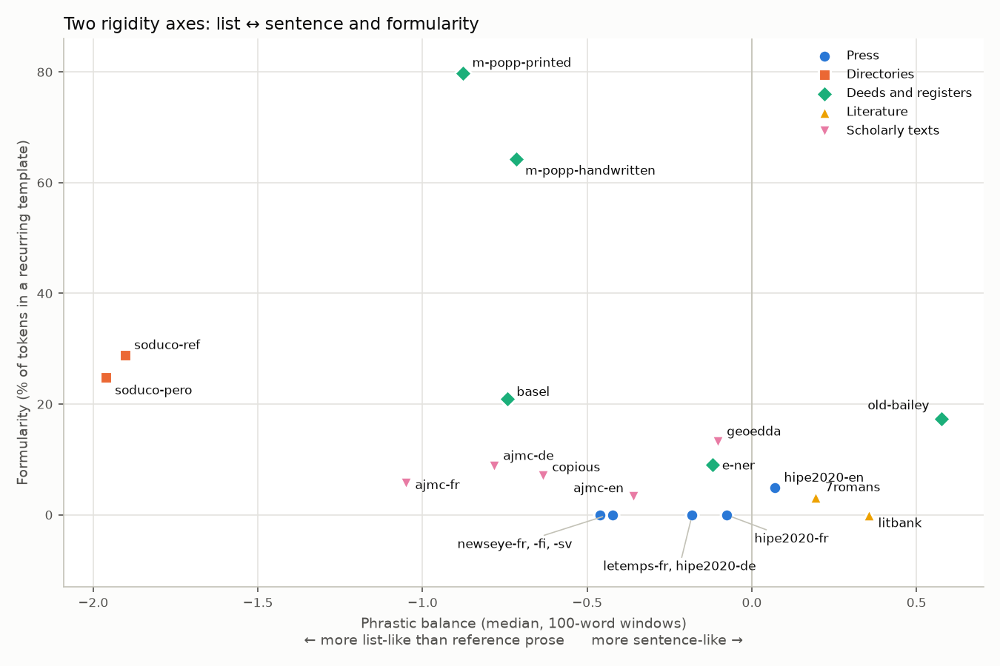

# Comment mesurer la rigidité d'un texte

*Rapport technique : les indicateurs de rigidité retenus pour le projet IJDAR 2026 (ANR DECIDON)*

L'étude porte sur la sensibilité des modèles de reconnaissance d'entités nommées (NER) au caractère
plus ou moins rigide d'un corpus et d'un texte. Ce rapport présente les indicateurs retenus pour
mesurer cette rigidité, la stratégie d'analyse envisagée et les indicateurs écartés. Chaque section
s'ouvre sur un résumé en langage courant (dans un bloc de citation), puis donne la définition formelle,
les fonctions du package [`text_rigidity`](../../text-rigidity/README.md) qui l'implémentent
(appliquées dans le notebook
[`exploring_textual_rigidity.ipynb`](exploring_textual_rigidity.ipynb)), et les valeurs mesurées. La méthode expérimentale (modèles, régimes d'entraînement,
évaluation, analyse statistique) fait l'objet d'un document séparé :
[Comment tester la sensibilité des modèles NER à la rigidité des textes](../../docs/protocole-experimental.md).

Les chiffres viennent d'une relance faite le 23 octobre 2026 sur les datasets de la table, sauf les CR
du JORF de DECIDON, en attente de leur gold de référence. Elle porte sur 33 sous-corpus (langues,
variantes d'OCR, genres de NEM.fr) et 4 515 fenêtres de 100 et de 300 mots. Les scripts sont dans
[`dataset-validation/`](dataset-validation/README.md). Sauf mention contraire, une valeur est la
médiane des fenêtres de 100 mots d'un sous-corpus.

**Récapitulatif**

| indicateur | ce qu'il mesure | axe | niveau observé | échelle locale (100 mots) | échelle globale | signe de rigidité |
|---|---|---|---|---|---|---|
| [Formatage typographique](#s3) | signes qui mettent le texte en page : ponctuation, parenthèses, tirets, filets… | liste ↔ phrase | caractères | oui | oui | valeur haute |
| [Balance phrastique](#s4) | part des mots de liaison (verbes, déterminants, prépositions…), par rapport à la prose de référence de la langue | liste ↔ phrase | catégories grammaticales | oui | oui | valeur négative |
| [Formularité](#s5) | part du texte prise dans des gabarits qui reviennent ailleurs dans le dataset | formularité | suites de 4 tokens | oui | oui | valeur haute |
| [Densité de noms propres](#s6) | part des mots qui sont des noms propres | covariable : densité d'entités | catégories grammaticales | oui | oui | aucun (ce n'est pas une mesure de rigidité) |
| [Segments averbaux](#s4-2) (contrôle) | part des segments sans verbe conjugué | liste ↔ phrase | syntaxe | oui | oui | valeur haute |

**Sommaire**

1. [Le problème](#s1)
2. [Deux façons d'être rigide](#s2)
3. [Formatage typographique](#s3)
4. [Balance phrastique](#s4)
5. [Formularité](#s5)
6. [Densité de noms propres](#s6)
7. [Stratégie d'analyse à deux échelles](#s7)
8. [Limites](#s8)
9. [Validation : la relance sur les datasets du projet](#s9)
10. [Indicateurs non retenus](#s10)
11. [Références](#s11)

---

## 1. Le problème

> **En bref.** On veut savoir si un modèle NER se trompe davantage sur des textes rigides
> (annuaires, actes, registres) que sur de la prose libre, à deux échelles : celle d'un corpus entier
> et celle du contexte immédiat d'une entité. Il faut d'abord mesurer la rigidité à partir du texte
> seul, avec des indicateurs qui restent fiables sur une centaine de mots et qui ne dépendent ni de la
> langue ni des annotations.

Les indicateurs doivent respecter quatre contraintes :

* **Pas de gold.** Aucun indicateur n'utilise les entités annotées. Leur nombre et leurs frontières
  dépendent du schéma d'annotation de chaque dataset, et l'annotation n'est pas toujours exhaustive
  (Old Bailey). Corréler un tel indicateur aux scores NER mesurerait l'annotation autant que le texte.
* **Une même taille de fenêtre aux deux échelles.** Les indicateurs fondés sur des comptages varient
  avec la longueur du texte mesuré. Les valeurs locales et globales ne sont comparables que si elles
  portent sur des fenêtres de même taille, ici 100 mots.
* **La langue.** Tout outil propre à une langue (étiqueteur, texte de référence) est celui de la langue
  du texte. Les indicateurs retenus sont soit indépendants de la langue, soit calculés par rapport à
  une référence de la même langue.
* **La densité d'entités à part.** Un annuaire est à la fois rigide et très dense en entités. La
  densité peut gêner un modèle pour des raisons propres : entités collées, peu de contexte. On la mesure
  donc séparément ([§6](#s6)), comme covariable, pour pouvoir séparer les deux effets.

## 2. Deux façons d'être rigide

> **En bref.** Les données montrent deux formes de rigidité qui ne vont pas forcément ensemble. Une
> **liste** remplace la phrase par des champs séparés par des signes : « Martin, épicier, r. de Seine,
> 12 ». Une **formule** garde la phrase, mais la répète d'un acte à l'autre : « domiciliée à Paris,
> 7, rue des Prêcheurs, fille de Charles LEPAGE, décédé, et de Pauline VAPPEREAU, sa veuve ». Un
> annuaire est les deux à la fois ; un compte rendu de procès est formulaire sans être une liste ; un
> commentaire philologique ressemble à une liste sans être formulaire.

L'hypothèse de départ distinguait une rigidité *structurelle* (mise en page) et une rigidité
*syntaxique*. Les données ne confirment pas ce découpage. Les indicateurs typographiques et
grammaticaux varient ensemble : entre fenêtres françaises, le formatage typographique et la balance
phrastique corrèlent à ρ = −0,65. Ce n'est pas un défaut de mesure : dans une liste, les signes
*remplacent* la syntaxe. Comparez « Martin, qui exerce la profession d'épicier, demeure rue de Seine,
au numéro 12 » et « Martin, épicier, r. de Seine, 12 » : les virgules et l'abréviation tiennent la
place de la relative et du verbe. Structure et syntaxe sont donc les deux faces d'un même axe,
**liste ↔ phrase**, observé à deux niveaux, les caractères et les catégories grammaticales.

Le second axe, la **formularité**, est d'une autre nature. Une formule se répète *d'une entrée à
l'autre*, pas à l'intérieur d'une fenêtre : un acte de mariage de 250 mots ne contient son gabarit
qu'une fois. On ne la voit qu'en comparant la fenêtre au reste du dataset ([§5](#s5)).

Les deux axes sont bien distincts :

* **À l'intérieur des datasets**, la formularité ne suit pas la balance : la corrélation médiane entre
  fenêtres est de 0,02.
* **Entre datasets**, elles corrèlent à −0,48. Cette corrélation tient aux corpus qui sont les deux à la
  fois (SoDUCo, M-POPP, Bâle).
* **Les contre-exemples sont nets.** Old Bailey est formulaire (17 %) mais plus phrastique que la prose
  de référence (+0,58). Les commentaires d'ajmc sont proches de la liste (−1,05) mais peu formulaires
  (3 à 9 %).

## 3. Formatage typographique

> **En bref.** Les imprimeurs anciens avaient peu de moyens de mise en page (gras, colonnes, corps de
> caractère). Ils structuraient donc l'information avec des signes : points de conduite « ........ »,
> tirets entre les champs, parenthèses, pipes, accolades. L'indicateur compte ces signes pour 100 mots.

Le texte est d'abord nettoyé du balisage ajouté à la numérisation (Markdown, HTML), puis chaque signe
non alphanumérique est rangé dans une famille :

| famille | signes |
|---|---|
| `punctuation` (ponctuation) | `. , ; : ! ? …` |
| `brackets` (encadrants) | `( ) [ ] { } « » " “ ” „` |
| `separators` (séparateurs) | traits d'union isolés, tirets `- – — ―`, barres et puces `\| ¦ / \ · • _ ~` |
| `symbols` (symboles) | `§ ¶ † ‡ * ° № & % # +`, et tout caractère Unicode de catégorie S |
| `rules` (filets) | suites d'au moins 3 signes de filet, espacés ou non (`......`, `-----`, `* * *`), sauf les points de suspension `...` |

Règles de comptage :

* une suite d'un même signe (`--`, `...`, `!!`) compte pour **une** marque ;
* ne sont pas comptés les traits d'union et apostrophes internes aux mots (*Saint-Honoré*, *l'acte*),
  les césures de fin de ligne, ni les séparateurs décimaux ou de milliers (*1.500*, *3,5*).

$$
\text{typo} = 100 \times \frac{\text{nombre de marques typographiques}}{\text{nombre de mots}}
$$

Exemple : « Martin (J.-B.), épicier, r. de Seine, 12........ Lefèvre — boulanger | r. du Bac, 3. »
compte 14 mots et 15 marques, soit 107 marques pour 100 mots. Les deux premières phrases de *Du côté de
chez Swann* en comptent 24.

| sous-corpus | typo |
|---|---|
| SoDUCo (référence / OCR Pero) | 77,5 / 74,9 |
| ajmc (fr, de, en) | 37 – 48 |
| M-POPP (dactylographiés / manuscrits) | 29,0 / 17,5 |
| presse (hipe2020, letemps, newseye) | 14 – 27 |
| littérature (7romans, LitBank) | 16 – 24 |
| oral transcrit (NEM.fr spoken) | 1,0 |

**Fiabilité.** L'indicateur sépare aussi bien les datasets sur 100 mots que sur 300 (η² = 0,56 et
0,57, [§9](#s9)). L'effet de langue reste faible (0,07 à 0,19).

**Ce qu'il faut savoir.**

* Le bruit d'OCR fabrique des signes parasites. La variante `typo_no_punctuation`, qui ne garde que
  les signes de mise en page, y est encore plus sensible : on l'utilise comme détail, pas comme
  indicateur principal.
* La ponctuation est aussi un trait de style : les points-virgules de Proust ne structurent pas une
  liste.
* Les conventions de transcription pèsent sur la valeur :
  * les actes dactylographiés de M-POPP comblent les blancs du formulaire avec des astérisques
    (3,8 pour 100 mots) ;
  * l'oral de NEM.fr est transcrit presque sans ponctuation.

Code : `strip_markup`, `count_typographic_marks`, `compute_typographic_formatting` (`text_rigidity.typography`).

## 4. Balance phrastique

> **En bref.** Une phrase tient grâce à ses « mots de liaison » : verbes, déterminants, prépositions,
> pronoms, conjonctions. Une liste s'en passe. On compte la part de ces mots dans la fenêtre et on la
> compare à celle d'une prose de référence de la même langue. Une valeur négative signale un texte
> moins lié que la prose de référence, donc plus proche de la liste ; une valeur positive, un texte
> plus lié, typiquement un récit.

### 4.1 Définition

Les catégories sont les étiquettes universelles UPOS [[Petrov 2012](#ref-petrov), [Nivre 2020](#ref-ud)],
attribuées par le modèle spaCy de la langue du texte [[spaCy](#ref-spacy)]. On compte les mots de
liaison $L$ (`VERB`, `AUX`, `DET`, `ADP`, `PRON`, `SCONJ`, `CCONJ`) parmi les mots, en excluant les noms
propres (`PROPN`) et les signes (`PUNCT`, `SYM`, `X`) :

$$
B = \log_2 \frac{n_L + 0{,}5}{n_{\text{autres}} + 0{,}5} \;-\; \left(\log_2 \frac{n_L}{n_{\text{autres}}}\right)_{\text{référence}}
$$

La référence est le treebank PUD de la langue [[Zeman 2017](#ref-pud)] : les mêmes 1 000 phrases de
presse et de Wikipédia dans chaque langue, ré-étiquetées par le même modèle spaCy que les documents.
$B = 0$ signifie autant de liaison que cette prose moderne.

Trois choix de construction :

* **Le signe porte l'information.** C'est un log-ratio entre deux groupes de catégories, au sens de
  l'analyse des données de composition [[Aitchison 1986](#ref-aitchison)]. Contrairement à une
  divergence, il dit dans quel sens le texte s'écarte de la référence.
* **Les noms propres sont exclus**, pour que la balance ne mesure pas la densité d'entités par
  construction. Celle-ci est mesurée à part ([§6](#s6)).
* **Les signes sont exclus**, pour ne pas doublonner le formatage typographique.

| sous-corpus | B |
|---|---|
| SoDUCo | −1,90 / −1,96 |
| ajmc-fr | −1,05 |
| M-POPP, Bâle | −0,72 à −0,88 |
| presse | −0,46 à +0,07 |
| littérature (7romans, LitBank) | +0,19 / +0,36 |
| Old Bailey (témoignages rapportés) | +0,58 |

**Fiabilité.** Séparation des datasets : 0,56 sur 100 mots, 0,71 sur 300. L'effet de langue est faible :
dans hipe2020, les trois langues donnent −0,08 (fr), +0,07 (en) et −0,18 (de), soit η² = 0,07.

**Ce qu'il faut savoir.**

* L'extrémité positive de l'axe relève du registre : un récit à la première personne est très lié
  sans être pour autant « plus fluide ». Pour la NER, la rigidité correspond à la moitié négative.
  Cette extrémité rejoint le premier axe de [[Seghier 2026](#ref-seghier)], qui oppose un pôle
  « impliqué » (pronoms, verbes) à un pôle « référentiel » (noms, nombres).
* Les modèles spaCy sont entraînés sur la langue moderne. Sur un état de langue ancien (l'allemand
  des XVe–XVIIIe siècles de Bâle) ou un texte mêlé de grec (ajmc), la balance
  mesure aussi les erreurs d'étiquetage.

Code : `compute_phrastic_balance` (`text_rigidity.phrastic`).

### 4.2 Segments averbaux (contrôle)

On découpe la fenêtre en segments, d'un signe de fin (`. ; : ! ? … |`) ou d'un saut de paragraphe au
suivant. Les sauts de ligne simples ne coupent pas, car dans un OCR de presse ils suivent la colonne
et non la syntaxe : couper sur eux faisait passer hipe2020 de 0,20 à 0,52. On compte la part des
segments de 3 mots ou plus qui ne contiennent aucun verbe conjugué (trait UD `VerbForm=Fin`). C'est
la notion de phrase averbale [[Lefeuvre 1999](#ref-lefeuvre)] appliquée à la fenêtre.

Résultats : SoDUCo 1,00, M-POPP et Bâle 0,50 à 0,55, presse 0,12 à 0,31, littérature 0,11 à 0,20,
oral et politique 0,00 à 0,05.

L'indicateur dit en clair ce que mesure la balance. Il lui est cependant redondant (ρ = −0,71 entre
fenêtres françaises, −0,81 entre datasets) et sépare moins bien les datasets (0,43 contre 0,56). On le
garde donc comme contrôle, hors du jeu de base.

Code : `compute_verbless_rate` (`text_rigidity.phrastic`).

## 5. Formularité

> **En bref.** Un acte de mariage, une entrée d'annuaire ou un compte rendu de procès suivent un
> gabarit : les mêmes tournures reviennent d'un document à l'autre, seuls les noms et les nombres
> changent. Pour le voir, on compare la fenêtre au reste de son dataset : quelle part de son texte
> est faite de suites de mots qu'on retrouve souvent ailleurs ? Les noms propres et les nombres sont
> remplacés par un symbole, pour que « Martin, épicier, rue de Seine, 12 » et « Durand, boulanger,
> rue du Bac, 3 » partagent le même gabarit.

### 5.1 Définition

1. **Séquence de tokens.** Chaque token spaCy est mis en minuscules ; les noms propres deviennent
   `<NAME>` et les nombres `<NUM>`. Les signes sont gardés, parce qu'ils font partie des gabarits ; les
   espaces et sauts de ligne sont retirés.
2. **Référence.** On tire du dataset des extraits de 500 mots, à tour de rôle dans les documents,
   jusqu'à 20 000 tokens. Pour une fenêtre du document $d$, la référence ne contient que des extraits
   d'*autres* documents : ainsi, un document ne se reconnaît pas lui-même.
3. **Gabarits.** Un 4-gramme de la fenêtre est un gabarit s'il apparaît au moins 3 fois dans la
   référence et s'il contient au moins un mot. Une suite faite uniquement de `<NAME>`, de `<NUM>` et
   de signes ne compte pas.
4. **Mesure.**

$$
F = 100 \times \frac{\big|\{\text{tokens de la fenêtre couverts par au moins un gabarit}\}\big|}{\text{nombre de tokens de la fenêtre}}
$$

C'est le principe des *lexical bundles* de [[Biber, Conrad & Cortes 2004](#ref-biber2004)] : des suites
de mots repérées par leur seule fréquence, qui servent à caractériser les registres. Il est ici
adapté de trois façons : la fréquence est comptée par rapport au dataset de la fenêtre, les noms
propres et les nombres sont masqués, et on mesure une couverture.

| sous-corpus | F (%) |
|---|---|
| M-POPP (dactylographiés / manuscrits) | 79,8 / 64,3 |
| SoDUCo (référence / OCR Pero) | 28,8 / 24,8 |
| Bâle (registres fonciers) | 20,9 |
| Old Bailey (procès) | 17,4 |
| GeoEDdA (Encyclopédie) | 13,2 |
| E-NER (documents réglementaires) | 9,0 |
| ajmc, COPIOUS | 3 – 9 |
| hipe2020-en / 7romans | 4,9 / 3,1 |
| presse fr, de, fi, sv ; LitBank | 0,0 |

**Fiabilité.** C'est l'indicateur qui sépare le mieux les datasets : 0,69 sur 100 mots, 0,82 sur 300. Il
dépend peu du seuil : les classements obtenus avec 2, 3 ou 5 occurrences corrèlent entre 0,97 et 0,99.
L'effet de langue est nul dans newseye (0,02). Il est plus marqué dans hipe2020 (0,24), où la partie
anglaise (4,9 %) se distingue des parties française et allemande (0 %).

**Robustesse** ([`../formularity-robustness/`](../formularity-robustness/README.md)).
* Exiger que le gabarit apparaisse dans au moins 2 ou 3 documents distincts de la référence, comme pour les
  *lexical bundles*, ne change pas l'ordre des datasets (ρ = 0,99). La formularité n'est donc pas faite de
  répétitions propres à un seul document.
* Elle classe les datasets comme le Self-BLEU [[Zhu 2018](#ref-zhu2018)], calculé sur la même référence (ρ = 0,96
  entre médianes). Contrairement au Self-BLEU, elle ne dépend pas de la langue : η² de la langue dans newseye = 0,02
  contre 0,25.
* Les 4-grammes sont un compromis : les 3-grammes captent des tournures banales de la langue, les 5-grammes
  effacent les formules courtes.

**Ce qu'il faut savoir.**

* **La valeur dépend du dataset de référence.** Elle mesure ce qui est formulaire *dans ce corpus*,
  donc ce qu'un modèle entraîné sur lui verrait souvent ([§7](#s7)). Un dataset hétérogène paraît
  peu formulaire par construction.
* **Il faut une référence assez grande.** En dessous de 15 000 tokens, la valeur n'est pas comparable :
  les genres de NEM.fr (2 000 à 5 000 tokens chacun) n'ont donc pas de formularité.
* **Le masquage la rapproche de la densité de noms propres.** Une formule pleine de noms (« Before
  Mr. Justice `<NAME>` », « `<NAME>` was indicted for ») compte comme gabarit. À l'intérieur des datasets,
  la formularité corrèle à 0,31 en médiane avec la densité de noms propres, jusqu'à 0,79 pour GeoEDdA.

Code : `FormularityReference`, `compute_formularity` (`text_rigidity.formularity`).

## 6. Densité de noms propres

> **En bref.** C'est la part des mots que l'étiqueteur reconnaît comme noms propres. Elle ne mesure
> pas la rigidité, mais la densité d'entités, une autre cause possible d'erreurs : entités collées,
> peu de contexte pour décider du type, longues énumérations. On la mesure à partir du texte, sans le
> gold, pour pouvoir séparer son effet de celui de la rigidité.

$$
D = 100 \times \frac{n_{\texttt{PROPN}}}{\text{nombre de mots (hors signes)}}
$$

| sous-corpus | D (%) |
|---|---|
| SoDUCo | 34 |
| ajmc, Bâle, M-POPP | 13 – 21 |
| presse | 4,5 – 12 |
| littérature | 3,0 – 3,5 |
| NEM.fr | 1 – 9 |

**Validation contre le gold.** La densité de noms propres a été comparée, fenêtre par fenêtre, au
nombre d'entités gold PER, LOC et ORG pour 100 mots. Le gold ne sert ici qu'à valider
l'indicateur, jamais à le calculer.
* La corrélation médiane à l'intérieur des datasets est de 0,66. Elle va de 0,74 à 0,88 dans hipe2020,
  newseye-fr et -sv, 7romans, GeoEDdA et Old Bailey.
* Entre datasets, elle est de 0,51.
* L'accord est faible pour ajmc (0,05 à 0,41) et letemps (0,33). Pour ajmc, c'est probablement parce
  que spaCy étiquette comme noms propres les références et les titres d'œuvres, que le gold range dans
  d'autres classes (`scope`, `work`).

**Ce qu'il faut savoir.** Les textes en liste sont aussi les plus denses en noms propres : entre
fenêtres françaises, la densité corrèle à 0,69 avec le formatage typographique et à −0,66 avec la
balance. Dans un modèle statistique, ces variables sont donc partiellement colinéaires ; il faudra
le vérifier avant d'interpréter leurs effets séparément ([protocole, section 10.5](../../docs/protocole-experimental.md#s10-5)).

Code : `compute_name_density` (`text_rigidity.phrastic`).

## 7. Stratégie d'analyse à deux échelles

> **En bref.** Les mêmes indicateurs sont mesurés, sur des fenêtres de même taille, à deux échelles. À
> l'échelle **globale**, des fenêtres tirées au hasard décrivent chaque corpus. À l'échelle **locale**,
> une fenêtre autour de chaque entité décrit son contexte. Le protocole complet est décrit dans un
> document séparé, [Comment tester la sensibilité des modèles NER à la rigidité des textes](../../docs/protocole-experimental.md) :
> régimes d'entraînement, évaluation des prédictions, modèle statistique, hypothèses.

Les principes qui concernent directement les indicateurs :

* **Une même taille de fenêtre, 100 mots, aux deux échelles.** Les indicateurs dépendent de la longueur
  du texte mesuré : des fenêtres de tailles différentes rendraient les valeurs locales et globales
  incomparables. La [section 9](#s9) montre que les indicateurs retenus restent fiables à cette taille.
* **Échelle globale.** On tire au plus 100 fenêtres par sous-corpus, sans chevauchement, à tour de rôle
  dans les documents, pour qu'un long document ne domine pas. Chaque sous-corpus est résumé par la
  médiane et l'écart interquartile de chaque indicateur.
* **Échelle locale.** La fenêtre compte environ 50 mots de part et d'autre de l'entité. Elle est décalée
  vers l'intérieur près des bords du document, pour garder 100 mots.
* **Masquage de l'entité.** À l'échelle locale, on étiquette le document entier, puis on retire les mots
  de l'entité des comptages, grâce au paramètre `exclude_spans` des fonctions. Ainsi les indicateurs
  décrivent le contexte de l'entité et non l'entité elle-même. Supprimer le texte de l'entité avant
  l'étiquetage fabriquerait une phrase artificielle (« née à , le onze mai »).
* **Formularité.** Sa référence dépend du régime d'entraînement. Pour un modèle utilisé sans
  entraînement, c'est le dataset entier. Pour un modèle entraîné sur une partie du dataset, ce sont les
  documents d'entraînement, c'est-à-dire ce que ce modèle a vu ([protocole, section 7.5](../../docs/protocole-experimental.md#s7-5)).

## 8. Limites

> **En bref.** Chaque indicateur capte un aspect de la rigidité, mêlé à d'autres facteurs : la qualité
> de l'étiquetage, l'OCR, les conventions de transcription, la taille et l'homogénéité des datasets.

* **Étiquetage.** La balance, les segments averbaux et la densité de noms propres reposent sur des
  modèles spaCy entraînés sur la langue moderne. Sur l'allemand ancien de Bâle, le grec d'ajmc ou un
  OCR bruité, ils mesurent aussi des erreurs d'étiquetage.
* **Référence de langue.** La balance vaut 0 pour la prose moderne de PUD (presse, Wikipédia). Ce zéro
  n'est pas un « degré zéro » de rigidité.
* **Formularité et taille des datasets.** Elle demande une référence d'au moins 15 000 tokens. Elle
  dépend de l'homogénéité du dataset et, par le masquage, de la densité de noms propres.
* **Corrélations entre datasets.** Elles reposent sur peu de corpus extrêmes (SoDUCo, M-POPP, Bâle). Les
  conclusions sur l'indépendance des axes viennent surtout des corrélations intra-dataset.
* **Préparation des données.** Certains textes n'ont pas d'information d'espacement d'origine et ont été
  recollés : 7romans, E-NER, ainsi que LitBank et Bâle, déjà tokenisés. Leurs comptes de signes en sont
  légèrement affectés. Les documents de GeoEDdA (regroupés par volume) et de Bâle (regroupés par
  identifiant) sont des regroupements de notre part. Old Bailey est représenté par un échantillon de 40
  sessions.
* **Couverture.** Les CR du JORF manquent encore. La version d'Old Bailey (XML officiel v7.2, procès de
  1834 à 1913) doit être confrontée à la sélection retenue dans le projet.

## 9. Validation : la relance sur les datasets du projet

**Données et procédure.**
* Les datasets bruts (`data/` à la racine du dépôt, provenance dans [`data/README.md`](../../data/README.md)) sont convertis dans un format commun
  par `loaders.py`.
* `compute_indicators.py` tire au plus 100 fenêtres de 100 et de 300 mots par sous-corpus et calcule les
  indicateurs avec le package `text_rigidity`.
* `analysis.py` produit les tableaux ci-dessous.
* Le notebook lui-même s'exécute de bout en bout, perplexité KenLM comprise (modèle CCNet français
  dans `models/`, téléchargé au besoin).

**Profils par sous-corpus** (médianes, fenêtres de 100 mots ; écarts interquartiles dans
`dataset-validation/results/iqr_100.csv`) :

| dataset | langue | famille | fenêtres | typo | balance | segments averbaux | formularité (%) | noms propres (%) |
|---|---|---|---|---|---|---|---|---|
| soduco-pero | fr | Annuaires | 100 | 74,9 | −1,96 | 1,00 | 24,8 | 33,5 |
| soduco-ref | fr | Annuaires | 100 | 77,5 | −1,90 | 1,00 | 28,8 | 33,8 |
| m-popp-printed | fr | Actes et registres | 100 | 29,0 | −0,88 | 0,55 | 79,8 | 19,0 |
| basel | de | Actes et registres | 100 | 22,0 | −0,74 | 0,50 | 20,9 | 20,0 |
| m-popp-handwritten | fr | Actes et registres | 100 | 17,5 | −0,72 | 0,50 | 64,3 | 15,2 |
| e-ner | en | Actes et registres | 100 | 12,0 | −0,12 | 0,17 | 9,0 | 9,5 |
| old-bailey | en | Actes et registres | 100 | 19,0 | +0,58 | 0,13 | 17,4 | 9,6 |
| ajmc-fr | fr | Textes savants | 100 | 47,5 | −1,05 | 0,50 | 5,8 | 13,1 |
| ajmc-de | de | Textes savants | 100 | 38,0 | −0,78 | 0,40 | 8,8 | 21,0 |
| copious | en | Textes savants | 100 | 25,5 | −0,63 | 0,50 | 7,0 | 17,9 |
| ajmc-en | en | Textes savants | 100 | 37,0 | −0,36 | 0,35 | 3,2 | 19,0 |
| geoedda | fr | Textes savants | 100 | 26,0 | −0,10 | 0,27 | 13,2 | 7,1 |
| newseye-sv | sv | Presse | 100 | 17,0 | −0,46 | 0,25 | 0,0 | 4,5 |
| newseye-fr | fr | Presse | 100 | 22,0 | −0,42 | 0,31 | 0,0 | 6,1 |
| newseye-fi | fi | Presse | 100 | 27,0 | −0,42 | 0,17 | 0,0 | 10,0 |
| hipe2020-de | de | Presse | 100 | 19,0 | −0,18 | 0,12 | 0,0 | 6,0 |
| letemps-fr | fr | Presse | 100 | 14,0 | −0,18 | 0,20 | 0,0 | 5,2 |
| hipe2020-fr | fr | Presse | 100 | 14,5 | −0,08 | 0,20 | 0,0 | 6,0 |
| hipe2020-en | en | Presse | 100 | 17,0 | +0,07 | 0,20 | 4,9 | 11,9 |
| 7romans | fr | Littérature | 100 | 24,0 | +0,19 | 0,20 | 3,1 | 3,0 |
| litbank | en | Littérature | 100 | 16,0 | +0,36 | 0,11 | 0,0 | 3,5 |
| nem-biomedical | fr | NEM.fr | 37 | 11,0 | −0,55 | 0,20 | — | 3,0 |
| nem-information | fr | NEM.fr | 25 | 16,0 | −0,43 | 0,33 | — | 7,1 |
| nem-juridique | fr | NEM.fr | 38 | 11,5 | −0,28 | 0,33 | — | 1,0 |
| nem-tweets | fr | NEM.fr | 28 | 18,5 | −0,26 | 0,00 | — | 9,1 |
| nem-encyclopedia | fr | NEM.fr | 50 | 12,5 | −0,18 | 0,15 | — | 9,0 |
| nem-poetry | fr | NEM.fr | 48 | 14,0 | −0,03 | 0,20 | — | 2,0 |
| nem-prose | fr | NEM.fr | 45 | 20,0 | −0,02 | 0,17 | — | 3,0 |
| nem-multi | fr | NEM.fr | 24 | 13,5 | −0,02 | 0,09 | — | 7,0 |
| nem-defense | fr | NEM.fr | 37 | 11,0 | +0,05 | 0,00 | — | 6,0 |
| nem-mail | fr | NEM.fr | 19 | 14,0 | +0,12 | 0,14 | — | 4,9 |
| nem-spoken | fr | NEM.fr | 50 | 1,0 | +0,16 | 0,00 | — | 2,0 |
| nem-politique | fr | NEM.fr | 28 | 11,0 | +0,20 | 0,05 | — | 3,0 |

Sur les quatre documents de calibration du notebook, typo, balance et segments averbaux valent :
- Proust : 10,9 / +0,46 / 0,06 ;
- annuaire : 85,1 / −1,83 / 0,99 ;
- débats : 17,4 / −0,24 / 0,27 ;
- acte : 18,2 / −0,36 / 0,40.

**Fiabilité.**
- La *séparation* est la part de la variance des rangs qui distingue les sous-corpus (η² ; plus haut =
  mieux).
- L'*effet de langue* est la même mesure entre les langues d'une même collection (plus bas = mieux) :
  hipe2020 fr, en, de ; newseye fr, fi, sv.

| indicateur | séparation, 100 mots | séparation, 300 mots | langue hipe2020 (100 / 300) | langue newseye (100 / 300) |
|---|---|---|---|---|
| formularité | **0,69** | **0,82** | 0,24 / 0,32 | 0,02 / 0,02 |
| typographie | 0,56 | 0,58 | 0,07 / 0,19 | 0,11 / 0,17 |
| balance phrastique | 0,56 | 0,71 | 0,07 / 0,17 | 0,00 / 0,02 |
| densité de noms propres | 0,58 | 0,66 | 0,18 / 0,11 | 0,10 / 0,17 |
| segments averbaux (contrôle) | 0,43 | 0,53 | 0,04 / 0,07 | 0,04 / 0,06 |
| *KL des POS (non retenue)* | 0,47 | 0,59 | 0,05 / 0,05 | 0,00 / 0,00 |
| *Distinct-2 (non retenu)* | 0,36 | 0,64 | 0,13 / 0,37 | 0,17 / 0,39 |
| *typo hors ponctuation (détail)* | 0,36 | 0,36 | 0,06 / 0,19 | 0,16 / 0,16 |

Tous les indicateurs retenus gardent l'essentiel de leur pouvoir de séparation sur 100 mots : ils sont
utilisables à l'échelle locale.

**Redondances** (Spearman entre fenêtres françaises de 100 mots) :
* sur l'axe liste ↔ phrase, typographie et balance corrèlent à −0,65, et la balance aux segments
  averbaux à −0,71 ;
* la formularité corrèle à −0,44 avec la balance et à 0,34 avec la typographie ; à l'intérieur des
  datasets, elle est indépendante de la balance (corrélation médiane 0,02) ;
* la densité de noms propres corrèle à 0,69 avec la typographie et à 0,63 avec la formularité
  ([§6](#s6)).

## 10. Indicateurs non retenus

> **En bref.** Les premières versions du notebook utilisaient d'autres indicateurs. Ils ont été écartés
> pour l'une de ces raisons : ils ne mesuraient pas ce qu'on croyait, ils dépendaient trop de la
> langue ou de la taille de l'échantillon, ou ils doublonnaient un indicateur plus fiable. Ils restent
> calculés par `get_all_metrics` pour comparaison avec les analyses précédentes.

| indicateur | pourquoi il n'est pas retenu | remplacé par |
|---|---|---|
| Compression zlib | Mesure en octets, donc sensible à l'encodage (le grec pèse plus lourd) et au balisage. Additionne répétitions de structure et de langue. Peu discriminant (η² ≈ 0,3 sur les tests préliminaires). | formularité (répétitions), typographie (structure) |
| Mots par ligne (« Uniformité ») | Dépend de la transcription (lignes physiques ou paragraphes) et n'est pas mesurable sur tous les datasets. Mesure une moyenne, pas une régularité. | rien dans le jeu de base ; descriptif pour les datasets à lignes physiques |
| Densité de ponctuation | Ne comptait que la ponctuation, et comptait le balisage Markdown du format pivot. | formatage typographique |
| Distinct-2 | Ne voit que les répétitions internes à la fenêtre, alors que les formules se répètent d'un document à l'autre. Sépare mal à 100 mots (0,36) et dépend de la langue (0,37 à 0,39 à 300 mots). | formularité |
| Entropie POS (ancienne) | Entropie des proportions d'étiquettes, insensible à l'ordre des mots : elle ne mesurait pas la syntaxe. Redondante avec la KL (ρ = −0,75 en français). L'article cité [[Bentz 2017](#ref-bentz)] porte sur les mots, pas sur les POS. | balance phrastique |
| Entropie des mots H₁, ĥ et ΔH = H₁ − ĥ | Voir ci-dessous. | formularité |
| MATTR [[Covington 2010](#ref-covington)] (TTR moyen sur 50 mots) | Comme Distinct-2, ne voit que les répétitions internes à la fenêtre. Dépend surtout de la langue (η² de la langue dans newseye : 0,64 à 300 mots) et sépare moins bien que la formularité (0,61 contre 0,82). | formularité |
| Taux d'entropie des POS | Sépare les annuaires par leurs proportions d'étiquettes, pas par l'ordre. Construction sans précédent dans la littérature. | balance phrastique |
| Divergence KL des POS | Ne donne qu'une ampleur, pas une direction : Proust (0,20) paraissait plus atypique que la presse (0,07). Sépare moins bien que la balance (0,47 contre 0,56 à 100 mots). | balance phrastique |
| Perplexité KenLM (CCNet) | Mélange l'imprévisibilité propre du texte et sa distance à Wikipédia : log₂ PPL = H(p) + DKL(p ‖ q). Configuration différente de CCNet : chiffres et accents non normalisés, texte scoré d'un bloc. Modèle français seulement. | aucun ; éventuelle covariable de qualité OCR après normalisation CCNet [[Wenzek 2020](#ref-ccnet)] |
| Segments averbaux | Redondants avec la balance (ρ = −0,71) et moins discriminants (0,43). | gardés comme contrôle ([§4.2](#s4-2)) |

**H₁, ĥ et ΔH.** [[Bentz 2017](#ref-bentz)] estiment sur les mots l'entropie unigramme H₁ et le taux
d'entropie ĥ (estimateur à fenêtre croissante, fondé sur les longueurs de répétition). Ils observent
que leur différence ΔH varie peu d'une langue à l'autre. Nos tests montrent trois choses :
- sur 300 mots, ĥ et H₁ sont presque identiques (ρ = 0,99) et ĥ doublonne Distinct-2 ;
- à 20 000 mots, ΔH sépare les annuaires des romans ;
- le **test du mélange** relativise ce dernier résultat. Après mélange aléatoire des mots, le vrai ΔH
  vaut 0, mais l'estimation reste à 2,4–2,7 bits : l'estimateur est fortement biaisé à ces tailles.
  Environ 70 % de l'écart entre SoDUCo et *Madame Bovary* vient de la forme du vocabulaire, et non
  de l'ordre des mots.

La formularité mesure directement ce que ΔH visait, la répétition de suites de mots, et elle reste
fiable sur 100 mots.

## 11. Références

Ont été vérifiées en ligne ou dans le texte :
- Aitchison 1986 et Biber 2004 (notices) ;
- Bentz 2017 et Seghier 2026 (texte intégral) ;
- le code de `cc_net` ;
- Lefeuvre 1999 : l'ouvrage et sa date sont confirmés, pas l'éditeur.

Les autres notices sont données de mémoire et restent à contrôler avant l'article.

**[Aitchison 1986]** J. Aitchison. *The Statistical Analysis of Compositional Data.* London : Chapman & Hall, 1986.

**[Bentz 2017]** C. Bentz, D. Alikaniotis, M. Cysouw and R. Ferrer-i-Cancho. *The entropy of words — Learnability and expressivity across more than 1000 languages.* Entropy, 19(6):275, 2017. <https://doi.org/10.3390/e19060275>

**[Biber, Conrad & Cortes 2004]** D. Biber, S. Conrad and V. Cortes. *If you look at…: Lexical bundles in university teaching and textbooks.* Applied Linguistics, 25(3):371–405, 2004.

**[Covington 2010]** M. A. Covington and J. D. McFall. *Cutting the Gordian knot: The moving-average type–token ratio (MATTR).* Journal of Quantitative Linguistics, 17(2):94–100, 2010.

**[Lefeuvre 1999]** F. Lefeuvre. *La phrase averbale en français.* Paris : L'Harmattan, 1999 (éditeur à vérifier).

**[Nivre 2020]** J. Nivre et al. *Universal Dependencies v2: An evergrowing multilingual treebank collection.* Proc. LREC 2020, 4034–4043, 2020.

**[Petrov 2012]** S. Petrov, D. Das and R. McDonald. *A universal part-of-speech tagset.* Proc. LREC 2012, 2089–2096, 2012.

**[Seghier 2026]** M. Seghier. *Du Genre au Continuum : Analyse Ascendante de la Variation Linguistique dans le Corpus NEM.fr.* Actes de CORIA-TALN 2026, RÉCITAL, 2–13, 2026. <https://hal.science/hal-05708437/>

**[spaCy]** M. Honnibal, I. Montani, S. Van Landeghem and A. Boyd. *spaCy: Industrial-strength natural language processing in Python.* <https://spacy.io>

**[Wenzek 2020]** G. Wenzek, M.-A. Lachaux, A. Conneau, V. Chaudhary, F. Guzmán, A. Joulin and E. Grave. *CCNet: Extracting high quality monolingual datasets from web crawl data.* Proc. LREC 2020, 4003–4012, 2020. Code : <https://github.com/facebookresearch/cc_net>

**[Zhu 2018]** Y. Zhu, S. Lu, L. Zheng, J. Guo, W. Zhang, J. Wang and Y. Yu. *Texygen: A benchmarking platform for text generation models.* Proc. SIGIR 2018, 1097–1100, 2018.

**[Zeman 2017]** D. Zeman et al. *CoNLL 2017 Shared Task: Multilingual parsing from raw text to Universal Dependencies.* Proc. CoNLL 2017 Shared Task, 1–19, 2017.
